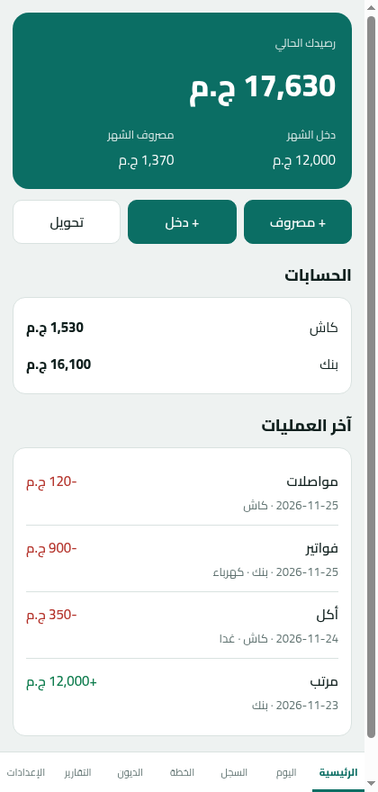

# حساباتي (Hesabati)

A personal finance tracker in Arabic (Egyptian dialect, right-to-left), built as a single-page web app and packaged as an Android app with Capacitor. Everything is stored locally on the device. There is no backend and no account.



*The screenshot uses sample data. Amounts are in Egyptian pounds (ج.م).*

## Features

- **Accounts**: cash, bank, or any account you add, each with an opening balance and a live balance.
- **Transactions**: add income, expenses, and transfers between accounts. Edit or delete any entry.
- **Today view**: browse any day, with spending totals and a breakdown by category.
- **Log**: a full transaction list with filters (text search, month, category, type, minimum amount).
- **Monthly budgets**: set a limit per expense category and see progress bars. The home screen warns when you reach 80% of a budget and when you exceed it.
- **Savings goals**: set a target amount and date, add money to a goal (it is recorded as a "savings" expense).
- **Recurring entries**: monthly income or expenses (rent, internet, subscriptions) that are added automatically on the chosen day (any day 1 to 31; short months use the last day).
- **Debts, installments, and associations (جمعيات)**: track money you owe and money owed to you, with partial payments and due dates.
- **Reports**: a donut chart of spending by category for a chosen month, comparison with the previous month, and a 6-month income vs. expense chart.
- **Settings**: light, dark, or automatic theme, optional PIN lock screen, and spending reminders.
- **Custom categories**: add, rename or delete income and expense categories from Settings.
- **Home extras**: a month-end spending forecast, comparison with last month, a backup reminder after 7 days, and an undo button after any delete.
- **Data tools**: backup as a `.json` file (on Android it opens the share sheet so you can send it to Drive, WhatsApp or Files) and restore from that file. The old copy-paste JSON text backup and restore are still there as a fallback ("نسخ كنص" and "لصق نص"), and the formats are the same, so old text backups still restore. CSV export is a shared file (with a text fallback).
- **Reminders (Android app only)**: local notifications at times you choose (defaults 14:00 and 21:00) asking you to log your spending, skipped if you already logged something recently. Includes a test notification button.

## Notes and limits

- Data lives in the browser's `localStorage` on one device. Take backups from Settings, because clearing app data deletes everything.
- The PIN is a screen lock stored as a SHA-256 hash. It does not encrypt the data. The app locks again after 60 seconds in the background. Backups never include the PIN, and restoring keeps your current PIN.
- Savings and debt payments are not counted as spending in the day view, reports and forecast. They still change account balances.
- Receipt photos (a 📎 on a transaction) are stored on the device only and are not part of backups.
- Recurring entries are added when the app opens or resumes, not while it is closed.
- The currency is fixed to ج.م.
- The UI text is Arabic only.
- The page loads the Cairo font from Google Fonts. Without internet it falls back to Tahoma or Arial.

## Tech

- Plain HTML, CSS, and JavaScript in one file: `www/index.html`. No framework and no build step for the web app.
- [Capacitor](https://capacitorjs.com/) 6 (`@capacitor/core`, `@capacitor/android`, `@capacitor/local-notifications`, `@capacitor/filesystem`, `@capacitor/share`) to package it for Android. App ID: `com.hesabati.app`.
- GitHub Actions workflow (`.github/workflows/android.yml`) that builds a debug APK.

## How to run

**In a browser**

Open `www/index.html` directly, or serve the folder:

```bash
git clone https://github.com/Ahmed-Elbqarey/hesapati.git
cd hesapati/www
python3 -m http.server 8000
```

Then visit http://localhost:8000.

**Android APK**

The easiest way is GitHub Actions. The "Build APK" workflow runs on every push to `main` or `master`, and can be started manually from the Actions tab. It uploads the debug APK as an artifact named `hesabati-apk`.

To build locally you need Node 20 and JDK 17 plus the Android SDK:

```bash
npm install
npx cap add android
npx cap sync android
cd android && ./gradlew assembleDebug
```

The APK is written to `android/app/build/outputs/apk/debug/app-debug.apk`. The workflow also adds the `POST_NOTIFICATIONS` and `RECEIVE_BOOT_COMPLETED` permissions to the Android manifest, which you need to do yourself for local builds if you want reminders.

## Changelog

### 1.2.0 (2026-11-26)

- Savings goal and debt payments no longer count as spending. Linked transactions update the goal or debt when edited or deleted.
- PIN stored as a hash, auto-lock after the app is in the background, PIN excluded from backups.
- Custom categories (add, rename, delete).
- Backup reminder, last backup date in Settings, backup restore validation. Old backups still restore.
- Recurring entries on days 29 to 31, CSV as a file, undo after delete, month forecast, last-month comparison, receipt photo per transaction.
- Refreshed look: shadows, gradient balance card, nav icons, animations.
- Not tested on a physical device at the time of release.

### 1.1.0 (2026-11-26)

- Backup is now a file: "حفظ نسخة (ملف)" saves `hesabati-backup-YYYY-MM-DD.json` and opens the Android share sheet (in a browser it downloads the file).
- "استرجاع من ملف" restores from a backup file after a confirmation, since it replaces all current data.
- The copy-paste text backup and restore stay as "نسخ كنص" and "لصق نص". Backups from version 1.0.0 restore with either method.
- Added the `@capacitor/filesystem` and `@capacitor/share` plugins.
- Not tested on a physical device at the time of release.

### 1.0.0

- First version: accounts, transactions, budgets, goals, recurring entries, debts, reports, PIN lock, reminders, copy-paste backup.

## License

No license file is included in this repository.

